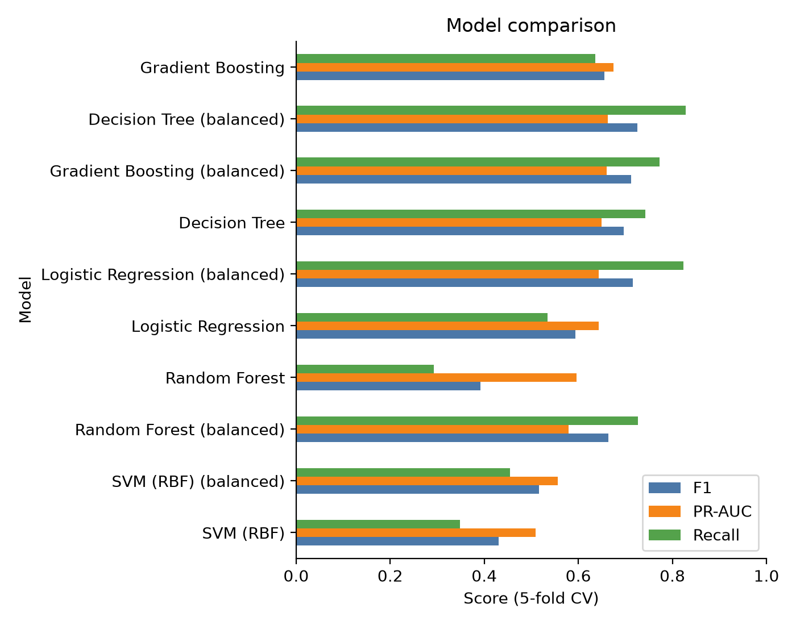
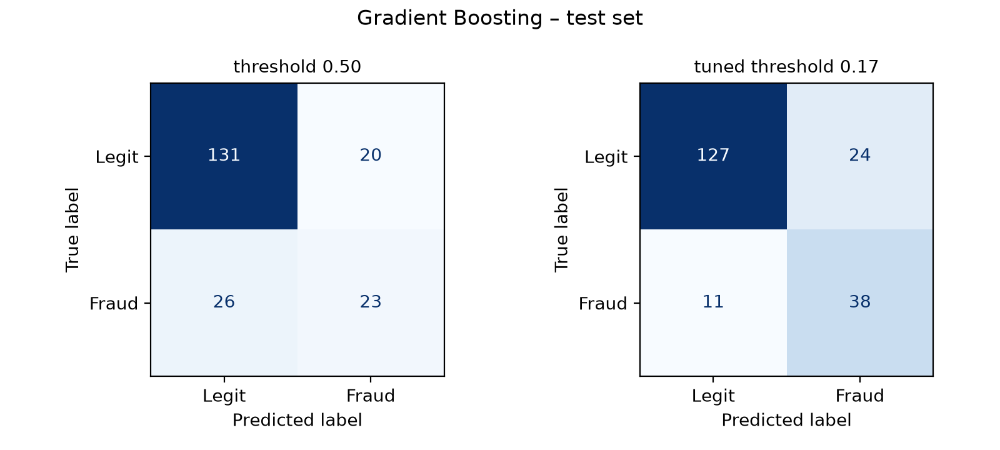
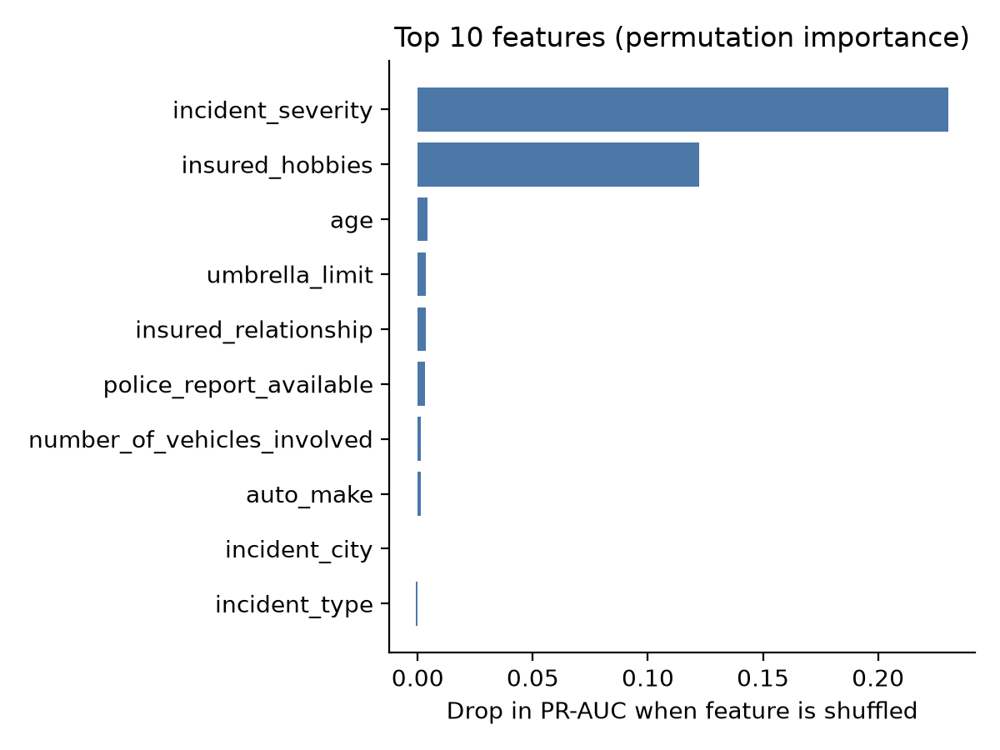

# Insurance Fraud Detection Using Machine Learning

Predicting whether an auto-insurance claim is fraudulent from policy, customer and incident data — comparing five classifier families (each plain and class-balanced), handling class imbalance, and tuning the decision threshold to catch more fraud.

  

## Highlights

- **Recall on fraud raised from 47% to 78%** for Gradient Boosting by tuning the decision threshold (0.50 → 0.17) on out-of-fold predictions; F1 went from 0.50 to 0.69 on the held-out test set.
- **Best test F1: 0.73** (Decision Tree, class-balanced) with 86% recall and 84.5% accuracy.
- **Key fraud signals:** incident severity and the insured's hobbies dominate permutation importance — everything else is close to noise.
- Clean, reproducible pipeline: ID and free-text columns dropped, all preprocessing inside scikit-learn `Pipeline`s, stratified 5-fold CV on the training set only.

## Problem

Insurance fraud is rare relative to legitimate claims (24.7% fraud in this dataset), so accuracy alone is misleading — a model that predicts "not fraud" every time scores 75%. This project focuses on **precision–recall trade-offs** and uses **PR-AUC** to pick the best model.

## Dataset

`insurance_claims.csv` — 1,000 auto-insurance claims, 36 features after cleaning (policy details, customer demographics, incident type/severity, claim amounts, vehicle info), target `fraud_reported` (Y/N).
Source: the public *Auto Insurance Claims* dataset on Kaggle.

## Approach

1. **Clean** — replace `?` with `Unknown`; drop identifiers, free-text location and empty columns.
2. **Feature engineering** — policy age at the time of the incident (days between bind date and incident date); injury/property/vehicle shares of the total claim.
3. **Split** — stratified 80/20 train/test (fixed seed).
4. **Preprocess** — `StandardScaler` for numeric, `OneHotEncoder` for categorical (rare levels grouped).
5. **Model comparison** — 5-fold stratified CV of Logistic Regression, Decision Tree, Random Forest, Gradient Boosting (`HistGradientBoostingClassifier`) and SVM (RBF), each with and without `class_weight="balanced"`, against a majority-class baseline.
6. **Threshold tuning** — pick the best model by PR-AUC, then choose the threshold that maximises F1 on out-of-fold probabilities.
7. **Evaluate** on the untouched test set; explain with permutation importance.

## Results (held-out test set)

| Model | Accuracy | Precision | Recall | F1 | ROC-AUC |
|---|---|---|---|---|---|
| Baseline (always "not fraud") | 0.752 | 0.000 | 0.000 | 0.000 | 0.500 |
| Gradient Boosting, threshold 0.50 | 0.770 | 0.535 | 0.469 | 0.500 | 0.822 |
| **Gradient Boosting, tuned threshold 0.17** | **0.825** | 0.613 | **0.776** | **0.685** | 0.822 |
| Logistic Regression (balanced) | 0.830 | 0.627 | 0.755 | 0.685 | 0.843 |
| **Decision Tree (balanced)** | **0.845** | 0.636 | **0.857** | **0.730** | 0.830 |
| Random Forest (balanced) | 0.820 | 0.607 | 0.755 | 0.673 | 0.839 |
| SVM (RBF) (balanced) | 0.805 | 0.639 | 0.469 | 0.541 | 0.858 |

Full tables: [`table1_cv_results.csv`](table1_cv_results.csv) (cross-validation) and [`table2_test_results.csv`](table2_test_results.csv) (test).

### Model comparison


### Effect of threshold tuning


### What drives fraud predictions


More figures in this repo (`fig1`–`fig6`): class distribution, precision–recall curves, fraud rate by incident severity and by hobby.

## Run it

```bash
python -m venv .venv
source .venv/bin/activate        # Windows: .venv\Scripts\activate
pip install -r requirements.txt
python fraud_detection.py --data insurance_claims.csv --out .
```

Or open `fraud_detection.ipynb` and **Run All**. Takes about a minute; figures (`fig*.png`), tables (`table*.csv`) and `summary.txt` are regenerated in the project folder.

## Project structure

```
├── fraud_detection.py      # full pipeline: cleaning → CV → threshold tuning → evaluation → plots
├── fraud_detection.ipynb   # runs the pipeline and displays results
├── insurance_claims.csv    # dataset
├── requirements.txt
├── fig1–fig6 *.png         # generated figures
├── table1–3 *.csv          # generated results tables
└── summary.txt             # all results in one file
```

## Limitations & next steps

- Small dataset (1,000 claims) — test-set metrics have wide confidence intervals.
- Try gradient-boosting libraries (XGBoost / LightGBM), SMOTE, and cost-sensitive thresholds that reflect the real cost of missed fraud vs. false investigations.
- Add SHAP explanations for individual claims.
